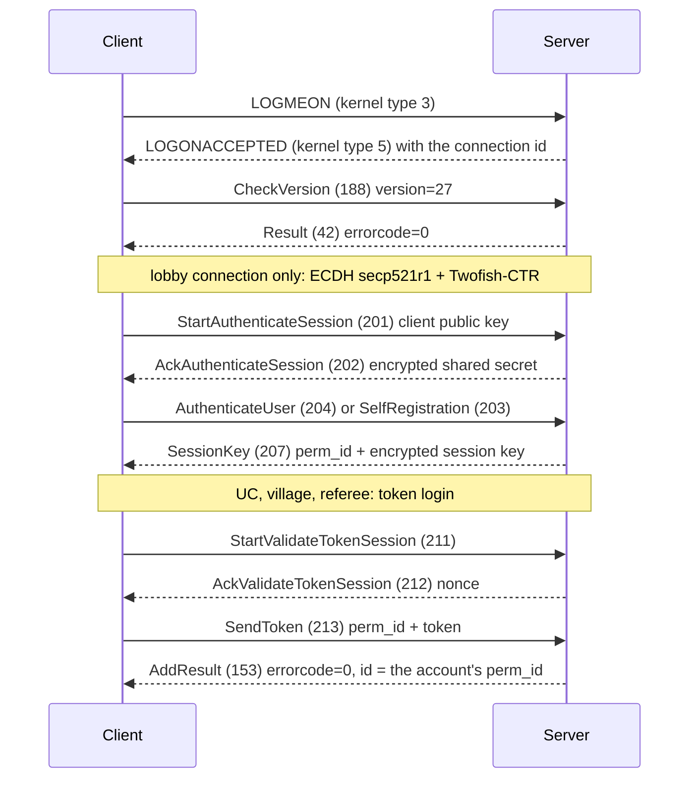
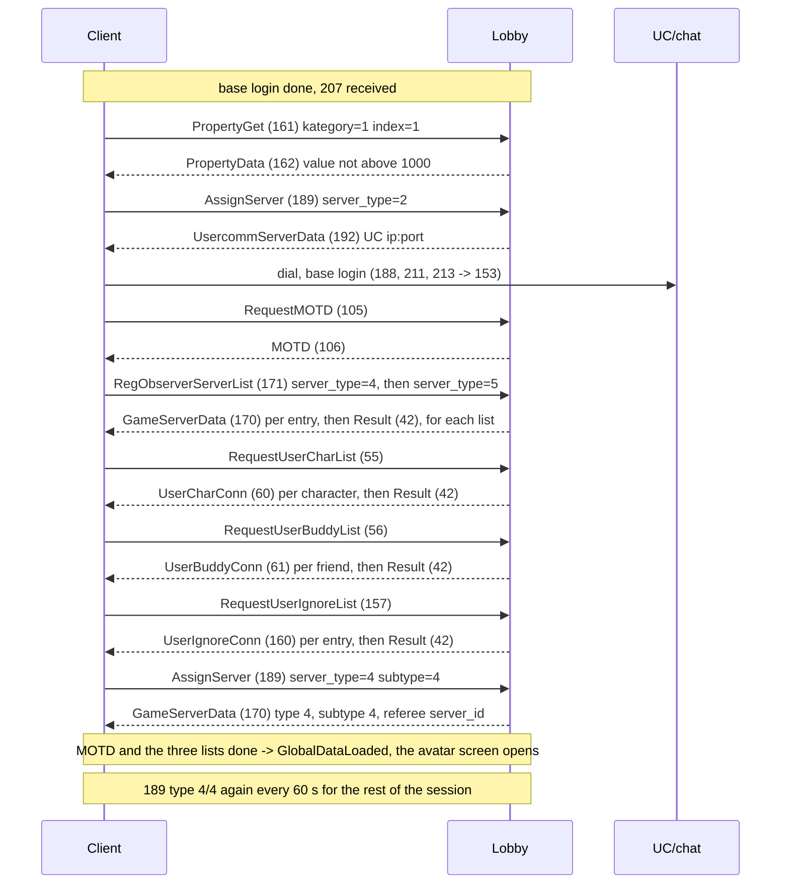
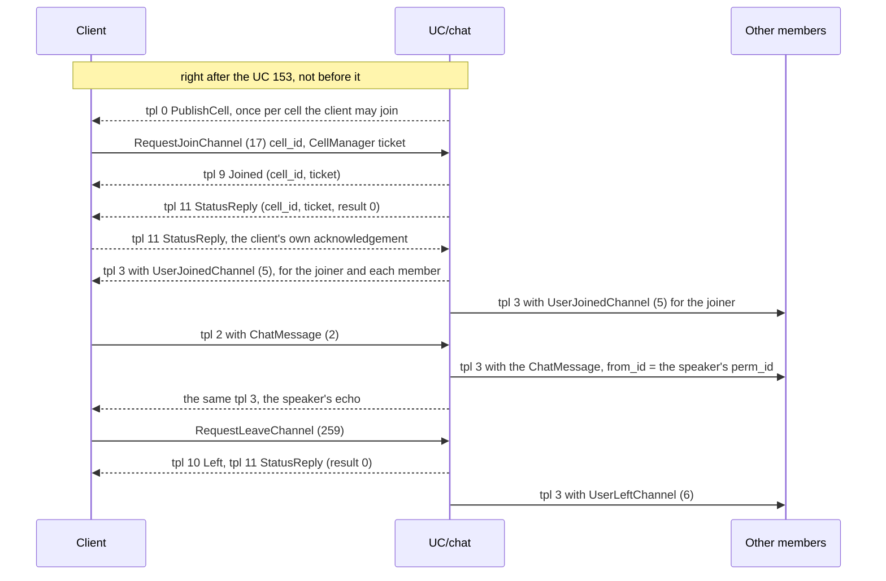
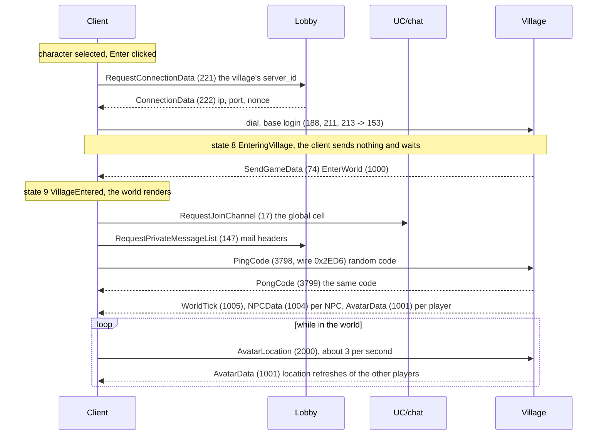
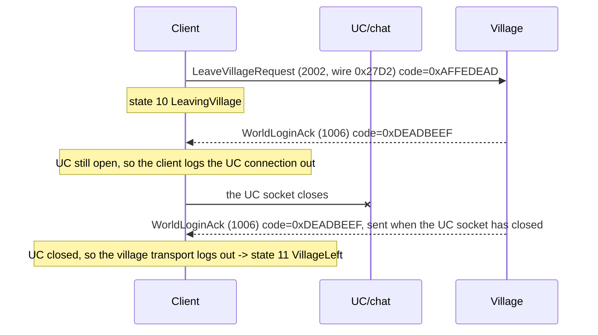
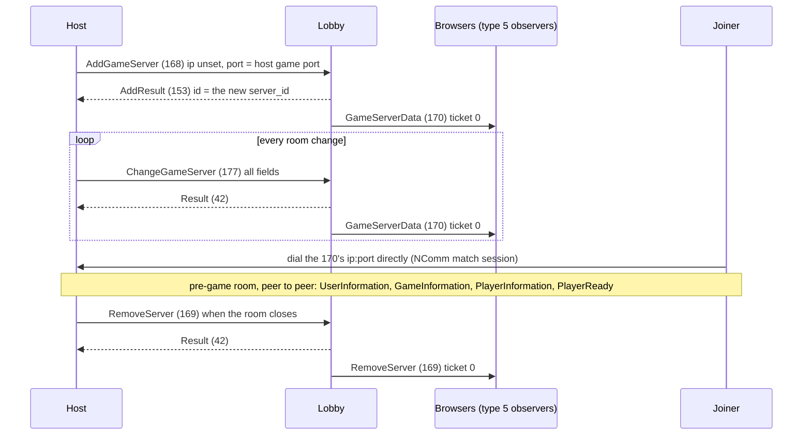
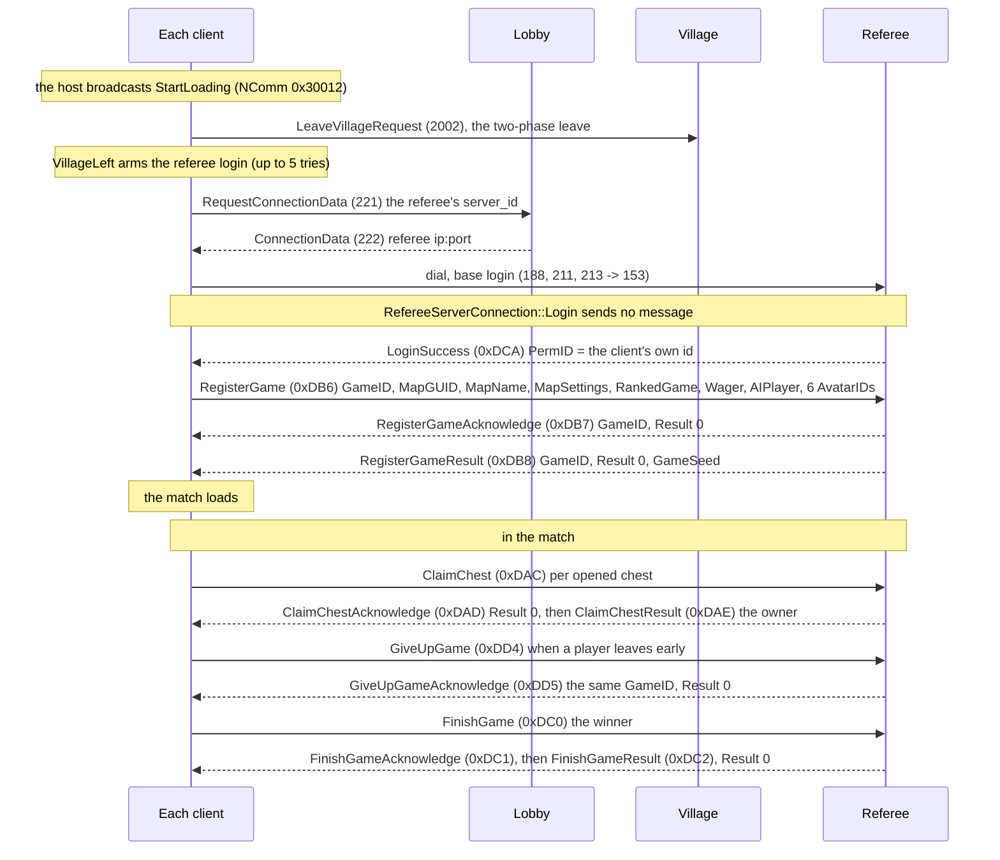

# SAdK lobby protocol: flow overview

A companion to the [S2 DNG lobby emulator's `API.md`](https://github.com/S2-modders/Settlers-DNG-lobby-emulator/blob/dev/API.md)
for **Die Siedler: Aufbruch der Kulturen** (SAdK), the German standalone on the same DNG engine. On top of the
DNG lobby, SAdK opens a UC/chat connection, a village connection (the 3D lobby world) and a referee connection
(the match arbiter).

This page is the flow-level view: which connection carries what, in which order, and which message answers
which. Everything else is in the per-message reference, `docs/message-catalog.md`: field layouts, bit widths,
binary addresses, the full list of server decisions, and every message the client sends or handles. Deeper
flows: `docs/village-and-character-protocol.md` (characters and the village), `docs/MATCH_START.md` (the
referee chain), `docs/NCOMM_GAME_PROTOCOL.md` (the pre-game room), `docs/s2tftp.md` (file transfer between
the players of a match), `lobby/docs/bridge-protocol.md` (the host bridge). The server is `lobby/sadk_lobby/`.

The NETMSG property-bag layouts come from the game's own `bin\msgdefs.ini` (the same schema is compiled into
`tincat3.dll`). It is authoritative for those layouts and is not distributed with this project: the server
reads a copy at `lobby/sadk_lobby/data/msgdefs.ini`. Village and referee message bodies are not in it; they
come from the binary.

Tags, as in the catalog: **[PROVEN]** = binary address plus live evidence with the real client; **[known]** =
read in the code; **[inferred]** = follows from code that was read, not observed; **[TODO]** = open.

---

## Connections

| Connection | The client dials | Login | Client receive side | Carries |
|---|---|---|---|---|
| Lobby | `LobbySettings.ini` host and port (the stub: 7070) | 188, then ECDH + Twofish: 201/202, 204 (203 for a new account), completed by **207 SessionKey** | tincat3 `HandlerLobby` | account, characters, MOTD, mail, friends, ignore list, server lists, hosting, connection data |
| UC / chat | ip:port of `192 UsercommServerData` (the stub: 7071) | 188, then token: 211/212/213, completed by **153 AddResult** | `HandlerUserComm` and the CellManager | chat channels, members, whispers |
| Village | ip:port of `222 ConnectionData` for the village's server id (the stub: 5477) | as UC | `HandlerGS` -> `VillageServerConnection::HandleMessage` S 00470a90 | the 3D lobby world: avatars, NPCs, shops, items, minigame tables |
| Referee | ip:port of `222 ConnectionData` for the referee's server id (the stub: 5481) | as UC, then the server pushes LoginSuccess | `HandlerGS` -> `RefereeServerConnection::OnReceive` S 0047b090 | match registration, chests, results |
| Ranking | ip:port of a `170` that answers `189` type 4 / subtype 5 | as UC | `HandlerStatSurf` | 252-257; no SAdK code opens it [inferred]; the hall of fame is a web page |
| Match (NComm, peer to peer) | the host's ip:port from the hosted game's `170` (host side: `network.ini` gamePort, 5479 by default) | — | `NComm_Manager::HandleEvent` S 0040e560 | pre-game room and the match; never reaches the lobby server |

- The client looks connections up by **server id**, so server ids must be unique across all kinds. A village
  whose id equals the UC server's id makes the client reuse the UC socket instead of dialling [PROVEN]. The
  stub uses 1 (UC), 50 (village), 77 (referee) and counts hosted games from 100.
- Only `222 ConnectionData` gives a server-id connection (village, referee) its address. A `170` does not,
  and listing a server in the browser creates no connection [PROVEN].
- The stub's host bridge (7072/7073) makes a game joinable when its host cannot accept incoming connections;
  it is not part of the original protocol (`lobby/docs/bridge-protocol.md`).

---

## Wire format in brief

Details and evidence: catalog, "Wire encoding".

### TinCat frame [known] [PROVEN]

Every connection is a TCP stream of frames: a 28-byte header, then the payload. All header fields are u32
little-endian.

| Offset | Field | Value |
|---|---|---|
| 0x00 | magic | `0xDABAFBEF` (on the wire `EF FB BA DA`) |
| 0x04 | from | sender id; the stub sends its server id `0xEFFFFFCC` |
| 0x08 | to | receiver id: the connection id assigned in the handshake |
| 0x0C | type | kernel frame type, below |
| 0x10 | unk1 | 0 |
| 0x14 | payload size | |
| 0x18 | CRC32 | over the payload: reflected polynomial `0xEDB88320`, **init 0, no final XOR** (not zlib). A bad CRC makes the client drop the connection |

Kernel frame types used on the lobby side:

| Type | Name | Use |
|---|---|---|
| 2 | CUSTOMDATA | carries every message below |
| 3 | LOGMEON | client handshake, 52-byte payload `{u32 0xDABAFBEF, u32 0xEFFFFFEE, name[32], password[8], u32 flags}` |
| 5 | LOGONACCEPTED | server reply, same shape: the assigned connection id at payload+4, password `"-"`. The client reads only the id, name and password fields |
| 0xB | STAYINGALIVE | keepalive; needs no reply |

### Module payload

A CUSTOMDATA payload starts with `u16 module id, u16 msgType`, followed by a property bag:

- **`0x26B6`**, the NETMSG layer (lobby, UC login and channel requests, village, referee): msgType is the
  NETMSG id, and the bag's first field `type` (UNSHORT) repeats it. The bytes are `B6 26 | id | id | body`.
- **`0x0062`**, tincat3's CellManager (chat cells, UC connection only): msgType is 0 and the bag's first field
  `id` (u16) selects a template, 0 to 11. `0x0062` is a module id, not a second NETMSG magic.

### Property-bag bodies (NETMSG) [known] [PROVEN]

Fields in `msgdefs.ini` order, no names, no padding:

| msgdefs type | Wire |
|---|---|
| `UNBYTE` / `SIBYTE` | 1 byte |
| `UNSHORT` / `SISHORT` | 2 bytes LE |
| `UNLONG` / `SILONG` | 4 bytes LE |
| `LBOOL` | 1 byte |
| `STRING n` | u32 LE length **including the NUL**, then the bytes; the receiver clamps to n |
| `MEMBLOCK` | u32 LE length, then the bytes |

- `None` and `""` differ on the wire: length 0 (the receiver keeps its default) versus length 1 and a NUL.
- A body shorter than the template is dropped; trailing bytes are ignored.
- **Tickets.** Each request carries a `ticket_id`, and its reply must carry the same one. The first matching
  reply consumes the ticket. Data rows on a ticket of the wrong request type are dropped, and each request
  type is completed only by its own reply kind: `Result (42)` for most; `AddResult (153)` for 84-87,
  150 AddPrivateMessage, 168 AddGameServer, 175/176 and the token logins. A missing or wrong-kind reply leaves
  that client manager busy for the rest of the session [known]. The catalog lists the completion message per
  request.

### LobbyMessages (village and referee bodies) [known] [PROVEN]

Village and referee messages ride the NETMSG envelope `SendGameData (74)` `{type u16, msg_type u32 LE, data
MEMBLOCK}` in both directions (or the server-only bundle `SendGameDataBundle (73)`). A bare LobbyMessage frame
is dropped [PROVEN].

- **Type word** (`msg_type`): bit 15 names mode (the server sends 0), bits 12-14 category, bits 0-11 the
  message id. The client sends village messages as category 2 (`0x2000 | id`) and minigame actions as
  category 5; referee messages are category 3 (`LoginSuccess` = `0x3DCA`). The village dispatcher ignores the
  category (the stub sends 0); the referee dispatcher uses `typeWord & 0xFFF`. Unknown ids are dropped
  silently.
- **Body** (`data`): an MSB-first bit stream with no field names and no alignment between fields; the last
  byte is zero-padded. Integers are n bits, most significant first, so a 32-bit value is big-endian when it
  starts on a byte boundary; a bool is 1 bit; a string is a u8 length plus the bytes, with no NUL; a raw
  buffer is the bytes only. In `RegisterGame (0xDB6)` every field after the 1-bit `RankedGame` is off byte
  alignment.
- `data` holds the fields only. Repeating the type word inside it, or writing a 32-bit field little-endian,
  is accepted and then ignored silently: the referee's `PermID` check and the village's `1006` code both fail
  without a log line [PROVEN].

---

## Base login (every connection) [known] [PROVEN]

- The lobby login completes on **207**. 153 completes only the token logins. To refuse credentials, answer
  203/204 with a `Result (42)`; the client treats any Result there as a failure.
- Token logins complete on **153**, never on `214 ValidateToken`: 214 is outside the jump table of the UC and
  server-id handlers and is dropped as an invalid message type. A Result (42) on the 211 ticket always fails
  the connection [known].
- The token is encrypted with the 207 session key and carries the 212 nonce inside; the nonce never comes back
  in clear [inferred].
- On the village and referee connections a non-zero 153 `id` overwrites the client's own perm id, so it must
  be the account's 207 perm_id [PROVEN 2026-10-07].
- 188 carries the constant version 27 and no patch level. The real version gate is `PropertyData (162)`
  during the lobby login, below.

---

## Lobby login (lobby connection) [known] [PROVEN]

- **Version gate.** The 162 `value` must not exceed the client's `[LobbyClient] ProtocolVersion` (1000 by
  default), compared signed, or the client disconnects with error 62. Without the 162 the login stops
  [known] [PROVEN] (the stub sends 0).
- **Order.** The client's state pump (S 00464ee0) issues these requests. Friends are requested after the
  MOTD and the character list are done, the ignore list after friends, so 157 is the last list request. The
  client also sends 53 RequestUsers and 158 RequestUserKeyList in this phase (each N rows, then Result).
  Login completes only when the MOTD, character, friend and ignore lists have all arrived; a missing reply
  leaves it stuck without any message [known].
- **One 192 per UC connection.** The client dials on every 192 it receives and never closes the extra
  sockets [PROVEN].
- **The two lists.** 171 server_type 4 lists villages (descriptor subtype 2), server_type 5 hosted games
  (subtype 1). Later changes are pushed as 170 with `ticket_id` 0 [PROVEN]; a removed game as 169 with
  `ticket_id` 0 [inferred].
- **Referee assign.** Answer each 189 type 4/subtype 4 with exactly **one** 170 on its ticket, server type 4
  and subtype 4. A **4/5** reply is diverted to tincat3's ranking manager and the game never learns the id;
  a second reply never reaches the assign path, because the ticket is consumed once. The exact 60 s re-send
  cadence shows that the id was latched; if the first assign fails, the client never asks again in that
  process. Only `server_id` is used from this 170; the address comes later from 221/222 [PROVEN]. Keep the id
  stable: a different id on a retry closes the existing referee connection [known].

---

## Chat (UC connection)

- The UC socket carries two layers: NETMSGs (module `0x26B6`) for the token login, 17 and 259; and CellManager
  templates (module `0x0062`) for everything else. The chat NETMSGs 2, 3, 5, 6, 30 and 76 travel inside
  templates 2 (client to server) and 3 (server to client) as embedded property bags [known].
- Publish every cell before the client joins it, including the per-zone local cells. The client answers a join
  of an unpublished cell with StatusReply 2 and drops that cell's chat silently [PROVEN 2026-08-02]. Publishing
  before the 153 crashed the client [PROVEN].
- The cell ids come from the village's EnterWorld channel map (global, local per zone, minigame tab); the
  global cell is joined on world entry [PROVEN 2026-08-01]. A minigame table names its own cell [inferred].
- Joins and leaves complete only on the CellManager ticket, through template 11 (results: join 0, 1 or 0x12;
  leave 0 or 1; any other code leaves the request pending). A NETMSG `Result (42)` does not complete them
  [known].
- Send UserJoinedChannel (5) for every member before chat from that member arrives [PROVEN]. The speaker
  echo follows from the client's `self` flag [inferred].
- Whispers: the client sends WhisperChatMessage (30) in template 2 on cell 1. Deliver it as
  `PrivateChatMessage (3)` in template 3 to the target only, and echo it to the sender [inferred].
- UserLeftChannel (6) also goes to the remaining members when a player's UC connection closes [inferred].
- Not used by SAdK: 107/108 (global-chat observers), 165 Chat, and 240-251 (UC*) [inferred].

---

## Entering the village [PROVEN]

The avatar screen's **Enter** button needs a joinable village entry: a 170 with server type 4, subtype 2,
`running` = 1 (`running` = 0 removes a listed village) [known], and a `data` block of five bytes, a big-endian
u32 equal to the client's ProtocolVersion (1000) and one zero byte. Without that block the client logs
"Invalid Server Data Block" and Enter stays grey [PROVEN].

- The server **pushes** EnterWorld after the village 153; nothing on the wire asks for it [PROVEN]. No
  timeout for state 8 is known [inferred].
- EnterWorld carries the world name, the `ServerPerm` (chat lines from that id show as `[SYSTEM]`
  [inferred]), and a map from zone key to chat cell: `0xFF` global (required, auto-joined), `0xFE` minigame,
  `0x00`-`0x0F` local per zone. Cell id 0 is the invalid sentinel: a chat tab mapped to it drops every line
  silently [PROVEN 2026-08-01].
- Send WorldTick (1005) before the first 1001 location, from the same millisecond clock that stamps the
  waypoints; otherwise remote avatars vanish [PROVEN 2026-08-01].
- Avatar positions live in an 8-slot waypoint ring per remote avatar: keep refreshing them with 1001 (stale
  after 3 s), and send AvatarRemove (1003) when a player's village connection goes away [PROVEN 2026-08-01;
  the removal is inferred].
- An unanswered ping only lowers the link-quality indicator; the client re-pings every 30 s and does not
  disconnect. After a pong the next ping comes about 120 s later [known].

### Village messages

All ride `SendGameData (74)`. Field layouts, rules and server decisions: catalog, "Village / world connection";
the flows: `docs/village-and-character-protocol.md`.

| Ids | Direction | Messages | Role |
|---|---|---|---|
| 1000 | S->C | EnterWorld | world entry, pushed after the village 153 |
| 1001, 1002, 1003 | S->C | AvatarData, AvatarLoggedIn, AvatarRemove | other players' avatars: spawn and refresh (a repeated 1001 is movement), an optional arrival notice, removal |
| 1004 | S->C | NPCData | one per NPC; its action opens the shop, mailbox, tailor or minigame dialogs |
| 1005 | S->C | WorldTick | world clock |
| 1006 | S->C | WorldLoginAck | the **logout** trigger; send it only as the answer to 2002 |
| 2000 | C->S | AvatarLocation | own position; relay it to the others as 1001 |
| 2002 | C->S | LeaveVillageRequest | below |
| 3798, 3799 | C->S, S->C | PingCode, PongCode | keepalive; echo the code |
| 3001, 3002 | C->S | MoveItem, DeleteItemRequest | answered with item updates |
| 3100-3102 | S->C | ActiveItemsUpdate, InventoryUpdate, ItemsFullSync | equipped items and backpack |
| 3200, 3201 | S->C | LevelExpUpdate, StatsUpdate | level and XP; level, XP, gold and play money |
| 3600-3621 | both | OpenShop, ShopInventoryData, ShopBuy, ShopBuyResult, ShopSell, ShopSellResult | shops |
| 3950 | C->S | AvatarColorChange | tailor |
| 4000 | C->S | ChatCommand | nothing required |
| 2001; 204, 209, 220-222, 300-302, 400-403 (category 5) | C->S | CreateMiniGameTable; table actions (join, leave, amount, Dice, Poker, PawnChess) | tavern minigames |
| 216-220, 303 | S->C | MiniGameTableRemove, MiniGameTableUpdate, MiniGameTableCreate, MiniGameNoTableLeft, MiniGameNoPlayerSlotLeft, MiniGameHand | tavern minigames |
| 3910, 3930 | S->C | TradeRequest, TradeOffer | never send: the client cannot clear a pending trade |

Ids 204, 209 and 216-222 are also lobby NETMSG ids; the two sets live on different connections with different
encodings.

---

## Leaving the village [PROVEN 2026-07-26]

- `HandleWorldLoginAck` S 0046ec50 acts only on the code `0xDEADBEEF` (big-endian on the wire) and branches
  on whether the UC connection is still open, so a complete leave takes two 1006 with the UC close between
  them. The client sends 2002 once and never asks for the second 1006 [PROVEN].
- Closing the village socket instead also ends the leave, but through the connection-lost path: the client
  shows `!CONNECTION_LOST_TEXT`, and at match start it kicked both players [PROVEN 2026-07-26].
- Never answer 2002 with EnterWorld (the client re-enters instead of leaving), and never send 1006 at any other
  time: it logs the player out [PROVEN].
- At match start every client sends 2002; reaching VillageLeft arms its referee login (below).

---

## Hosting and joining a game

- 168 is completed by **153** with the new id [PROVEN]; a non-zero errorcode shuts the host's network down
  [known]. The host sends 177 only after that id has arrived.
- The client leaves 168 `ip` unset: the server fills the 170 `ip` with the host connection's address. The
  browser computes "occupied" as `max_spectators` (the host's human count) + `ai_players` and never reads
  `cur_players` for games; `password_required` follows from the 177 `cipher`; the `description` carries the
  settings, the wager and the player names and should be echoed verbatim. A hosted game carries no data block
  (the host's 168 sends none); the ServerDataBlock is for village entries only [known].
- A 170 cannot remove a game (games ignore `running`); only a pushed 169 with ticket 0 does [inferred].
- The joiner dials the host directly; 221/222 and the 223/224 TAN messages are not on this path [known]. The
  room protocol (slots, tribes, teams, colours, ready) is NComm, peer to peer: `docs/NCOMM_GAME_PROTOCOL.md`
  and the catalog's "Pre-game room".
- The host must accept inbound TCP on its game port: its match transport is a TinCat server that cannot dial
  out, and the client has no UPnP and no hole punching [known]. The stub's host bridge covers hosts that
  cannot (`lobby/docs/bridge-protocol.md`).
- A joiner that lacks the map gets it from the host over S2TFTP on the match connection (`docs/s2tftp.md`).

---

## Match start: the referee chain [PROVEN 2026-07-27]

- Host and joiners all run this chain; every client sends RegisterGame [PROVEN].
- `RefereeServerConnection::Login` S 004793f0 only opens the transport, so the server must **push**
  LoginSuccess after the referee 153. Its `PermID` must equal that client's own id (LobbyManager+0x54c),
  big-endian; on a mismatch the client returns silently [PROVEN]. Send it once per referee login: each one
  makes the client send RegisterGame again [inferred]. LoginFailed is never needed; after five failed tries
  the client aborts the match start [inferred].
- RegisterGameResult with Result 0 carries the GameSeed and starts the load; a non-zero Result carries a
  FailReason instead and shows `!REGISTER_GAME_FAILED`. The GameSeed seeds only the contents of the
  network-match chests: give every client of a match the same seed, or the clients disagree about the chests
  (the simulation does not desync) [live 2026-10-14]. The stub sends `0x5EED1234` to everyone.
- The in-match replies drawn above are the stub's, confirmed against two clients [PROVEN, server log
  2026-10-10]. The client's rules [known]: `0xDAD` must be Result 0 (a non-zero one tears the referee session
  down); `0xDAE` with a non-zero AvatarID grants the chest, and every claim of one chest should name the same
  owner, the claim's ActorID; `0xDD5` must echo the GameID, with Result 0 to 20 (21 and above crash the
  client); nothing subscribes to the FinishGame results, so the client does not wait for them.
- Gold, XP and wagers are the server's bookkeeping: no message carries amounts, and the player sees the
  outcome only in the character's stored gold, XP and level [known]. The stub's rules: catalog, `0xDB6`,
  `0xDC0` and `0xDD4`.
- Silent failure points, where a frame is accepted and nothing happens: a 4/5 assign reply, a 170 instead of
  a 222 for the referee address, a wrong or little-endian PermID, a type word repeated inside `data` [PROVEN];
  a 0xDB8 that arrives after the setup dialog has closed [known].

---

## See also

- `docs/message-catalog.md`: every message, its contract, the server behaviour the client needs, the open
  server decisions, and where the stub differs
- `docs/village-and-character-protocol.md`: characters, village entry, presence, NPCs, shops, minigames,
  leaving
- `docs/MATCH_START.md`: the referee chain and the match start in the client
- `docs/NCOMM_GAME_PROTOCOL.md`: the pre-game room (NComm, peer to peer)
- `docs/s2tftp.md`: file transfer between the players of a match
- `lobby/docs/bridge-protocol.md`: the host bridge
- `docs/SOURCEMAP.md`: named functions, structs and offsets
- `lobby/README.md`: running the server, and what it implements
